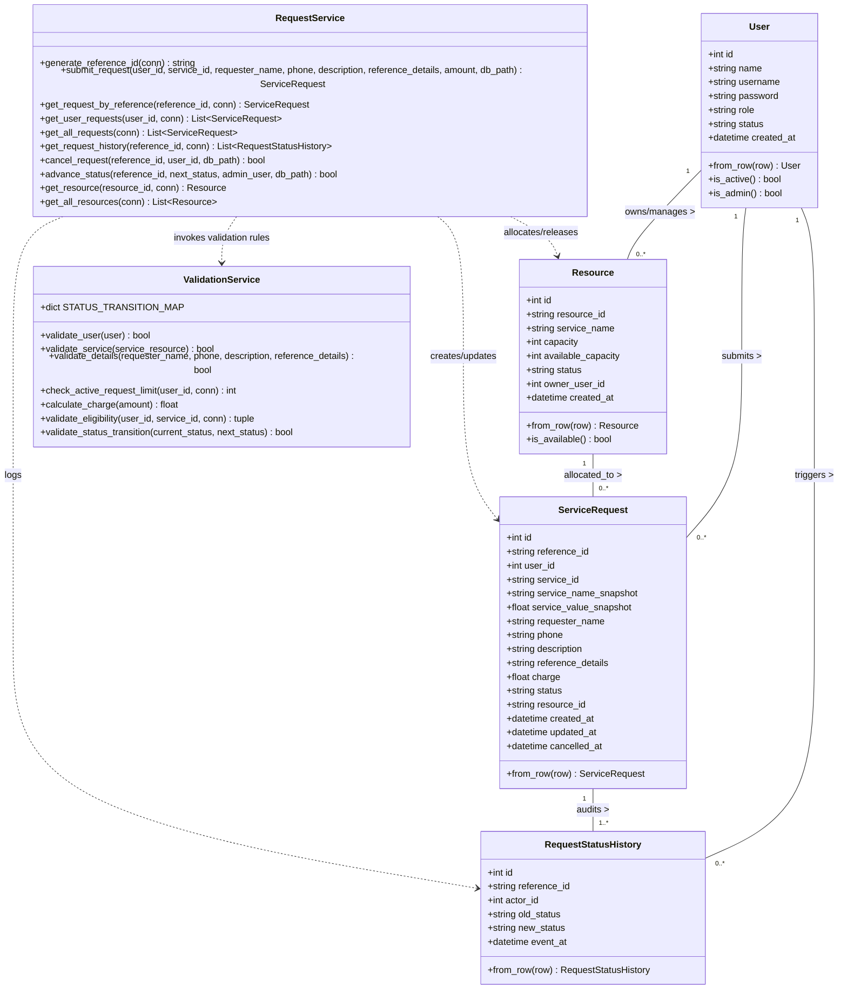

# UML Diagram 2: Class Diagram
**Project Title:** Certificate Request System  
**Institution:** Sri Eshwar College of Engineering  

---

## 1. Description
The Class Diagram illustrates the structural architecture of the **Certificate Request System**, showcasing domain entities (`User`, `Resource`, `ServiceRequest`, `RequestStatusHistory`), service managers (`ValidationService`, `RequestService`), their public operations, private attributes, multiplicities, and relationships.

---

## 2. Mermaid Class Diagram

---

## 3. Structural Multiplicities & Responsibilities

1. **User (1) to ServiceRequest (0..\*):**
   - Each registered student (`User`) can submit 0 or more certificate requests.
   - Enforced by `BR1`: A user can have at most 5 concurrently active requests.
2. **Resource (1) to ServiceRequest (0..\*):**
   - Each master catalog item (`Resource`: S101, S102, S103) is linked to zero or more submitted requests.
   - Allocating a request decrements `available_capacity` by 1; cancelling releases it by 1 (`BR9`).
3. **ServiceRequest (1) to RequestStatusHistory (1..\*):**
   - Every service request has at least one audit record (`SUBMITTED`), plus sequential logs for each stage advance (`APPROVED/ASSIGNED`, `IN_PROGRESS`, `COMPLETED`) or cancellation (`CANCELLED`).
4. **ValidationService:**
   - Central stateless service encapsulating business rules `BR1` (active limit), `BR2` (eligibility), `BR4` (charge calculation), `BR5` (field format validation), and `BR8` (status transition map).
5. **RequestService:**
   - Transactional service handling atomic request submissions (`BR6`, `BR7`), snapshots (`BR3`), resource quota locks, and role checks (`BR10`).
