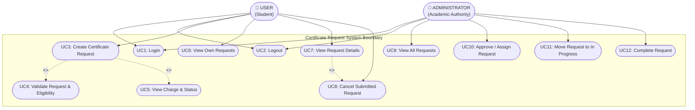

# UML Diagram 1: Use Case Diagram
**Project Title:** Certificate Request System  
**Institution:** Sri Eshwar College of Engineering  

---

## 1. Description
The Use Case Diagram visualizes the functional boundaries and behavioral interactions of the **Certificate Request System** with its two primary actors:
1. **User (Student Requester)**
2. **Administrator (Academic Office Authority)**

Relationships modeled include `<<include>>` dependencies for mandatory validation and fee calculation, and `<<extend>>` dependencies for optional user cancellation.

---

## 2. Mermaid Use Case Diagram

---

## 3. Use Case Specifications

| Use Case ID | Name | Actor | Description | Preconditions | Postconditions |
|-------------|------|-------|-------------|---------------|----------------|
| **UC1** | Login | User, Admin | Authenticates actor using credentials. | Account exists & is `ACTIVE`. | Session created; role dashboard loaded. |
| **UC2** | Logout | User, Admin | Terminates active session. | User logged in. | Session cleared; redirected to login. |
| **UC3** | Create Certificate Request | User | Submits new certificate application. | User logged in, active quota < 5. | Request created with `SUBMITTED` status. |
| **UC4** | Validate Request | System / User | Enforces BR1 (active quota), BR2 (eligibility), and BR5 (details). | Request data entered. | Request permitted or atomic rejection. |
| **UC5** | View Charge & Status | User | Calculates and displays statutory fee (BR4). | Fee base amount entered. | Charge computed (Rs.50 or Rs.0). |
| **UC6** | View Own Requests | User | Lists student's submitted applications (BR10). | User authenticated. | Personal requests table rendered. |
| **UC7** | View Request Details | User, Admin | Displays full request fields, BR3 snapshots, and history. | Request ID exists. | Detail view rendered. |
| **UC8** | Cancel Submitted Request | User | Cancels eligible request and restores quota (BR9). | Request owned by user & `SUBMITTED`. | Status set to `CANCELLED`; capacity +1. |
| **UC9** | View All Requests | Admin | Displays college-wide student requests. | Administrator logged in. | Master requests dashboard rendered. |
| **UC10** | Approve / Assign Request | Admin | Advances status `SUBMITTED` &rarr; `APPROVED/ASSIGNED`. | Request is `SUBMITTED`. | Status updated; audit history logged. |
| **UC11** | Move to In Progress | Admin | Advances status `APPROVED/ASSIGNED` &rarr; `IN_PROGRESS`. | Request is `APPROVED/ASSIGNED`. | Status updated; audit history logged. |
| **UC12** | Complete Request | Admin | Advances status `IN_PROGRESS` &rarr; `COMPLETED`. | Request is `IN_PROGRESS`. | Status updated; request completed. |
